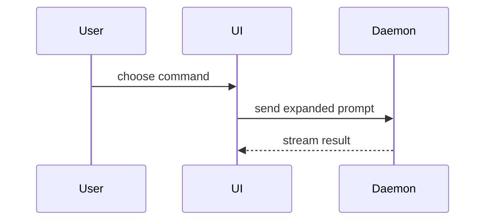

## Git State Requirements

This skill only describes changes already published on the intended remote head branch. Before generating a proposal or proceeding with PR creation or updates, verify both conditions:

- The working tree and index are clean, including no untracked files. Use `git --no-optional-locks status --porcelain=v1 --untracked-files=all`.
- The intended remote head branch exists and its current commit is exactly the local `HEAD`. Compare `git rev-parse HEAD` with a live read using `git ls-remote --heads <remote> refs/heads/<head>` or the GitHub API. Cached remote-tracking refs alone are insufficient. Local commits ahead of, behind, or diverged from that remote branch fail this check.

If either condition fails, or cannot be verified, stop the PR workflow, report the specific blocker, and ask the user to resolve it outside this skill. Do not generate a proposal, publish a PR, or repair the repository state. Recheck both conditions immediately before creating or updating the PR.

Do not commit, push, stage, edit repository files, or perform other operations that change the working tree, index, history, branches, tags, or remote Git state. This includes pull, merge, rebase, reset, stash, checkout/switch, branch creation/deletion, and fetch that updates local refs. Creating or updating a PR is permitted only under the publication approval rules below; that approval does not authorize Git mutations.

## Description Review and Interactive Question

When the user explicitly invokes `$github-pr` without an accompanying request, first verify the Git State Requirements, then inspect the repository and generate the proposed title and complete description using the workflow below. Show that proposal in chat before asking the interactive question; never ask the action question before the description is ready for review.

Check whether a matching open PR exists before presenting the question. Use the user's language. In Portuguese, ask "Deseja criar o PR no GitHub com esta descrição ou informar alterações necessárias?", with the suggested option "Criar PR no GitHub" and the question UI's free-text field for describing necessary changes. If a matching PR exists, use "Deseja substituir a descrição do PR no GitHub por esta ou informar alterações necessárias?" with "Aprovar e atualizar PR" instead.

Prefer `functions.request_user_input_async` when available, passing one question with the corresponding title and single suggested option. Use `functions.request_user_input` only when available and permitted by the current mode; adapt to its required option count and use its built-in free-text response. If neither interactive tool is available, ask the same question in chat.

Wait for the user's submitted answer before creating or updating a PR. A preselected option, no answer, or elapsed time does not authorize publication. Selecting creation approves publishing the displayed proposal; selecting the update approves replacing the existing PR description with the displayed proposal. If the user supplies necessary changes, revise the proposal, show the revised description, and ask again before publishing it, unless the answer explicitly authorizes publishing that revision. An explicit creation request can skip this question for a new PR; replacing an existing description still requires approval of the proposed replacement.

## Existing Descriptions

Generate the new description from the actual diff, repository instructions, and observed evidence. Disregard only the existing description stored in the matching PR on GitHub, including a body written by the user; do not preserve or merge that GitHub prose into the new description. Continue to honor instructions, proposed text, and requested revisions supplied by the user in the current conversation. Once the user approves the displayed replacement, overwrite the matching PR's body with the new description, even if the previous body was written by the user. This refers to the PR description (body), not a separate discussion comment. Keep the existing title unless the user also approves a title change. Reuse the existing PR instead of creating a duplicate.

## Write or Create a Pull Request

When the user asks only for a description, generate the body without publishing it. When the user asks to create or open a GitHub PR, carry the task through creation using the generated description.

1. Inspect the repository instructions, working tree, branch, remotes, and diff against the intended base. Honor a user-specified repository, base, head, and draft status; otherwise resolve them from repository context and the target remote's default branch. Ask only when meaningful ambiguity remains. Apply the Git State Requirements before continuing. Describe only the committed changes already present on the verified remote head branch.
2. Generate a concise title and body using the template below. Lead the Summary with the concrete problem and resulting behavior, followed by the smallest useful visual. Use `GLOSSARY.md` when available. Include only observed validation results and material merge risks.
3. Before publishing, check GitHub access and whether an open PR already exists for the same repository, base, and head. If a matching PR exists, follow the description review and replacement rules above: show the generated description, obtain approval, and replace its body. Do not merely return the existing PR or create a duplicate. For a description-only request, show the proposal without publishing it.
4. Use the existing, already published head branch without preparing, committing, or pushing anything. Recheck the Git State Requirements immediately before publication; if they fail, stop and report the blocker. If repository access or authentication is missing, preserve any already generated title and body and report the blocker.
5. Prefer an available GitHub tool with structured title and body fields. When using the GitHub CLI, save the exact Markdown body to a temporary UTF-8 file and pass it with `--body-file`, preserving real newlines. Specify the resolved repository, base, head, and title explicitly. Add `--draft` when requested. For example, with these values already resolved:

   ```bash
   gh pr create --repo "$pr_repo" --base "$pr_base" --head "$pr_head" --title "$pr_title" --body-file "$pr_body_file"
   ```

   Pass title and path values as quoted arguments; never interpolate generated prose into shell command text. Remove temporary files when they are no longer needed.
6. Verify the created or updated PR's URL, base, head, title, body, and draft status. If creation times out or its outcome is unclear, check whether the PR exists before retrying; do not repeat creation while the outcome remains unknown. In Codex, attach every created PR and any existing PR being updated with `mcp__codex_app__attach_artifact` when available. Return the PR link and briefly report validation or any remaining limitation. Creating a PR does not authorize merging it.

## PR Body

Use this template for writing the PR body:

```markdown
## Summary

<diagram, diff-sketch, or tree>

## Evidence

- **Before:** <screenshot/output/failing test run>
  **After:** <screenshot/output/passing test run>

## Merge Danger

**Door:** <one-way or two-way>

<optional: description>

**Blast Radius:** <one-word description>

<optional: potential ramifications of merge>
```

## Sections

Skip all preambles and keep prose brief. Use the user's domain language from `GLOSSARY.md` when available.

### Summary

Pick the smallest view that makes the key point clear.

- Show logic or an algorithm as pseudocode:

```text
on(save)
  if content is unchanged
    return cached result
  write new content
  return fresh result
```

- Show runtime control flow as a call tree:

```text
submitForm
  createSession
    persistPrompt
    launchAgent
  navigateToSession
```

- Show UI structure as a component tree, including state and module boundaries that matter:

```text
<SessionPage> (apps/example/src/routes/session.tsx)
  useSessionEvents()
  <SessionToolbar>
    <RunSkillButton> (packages/ui)
```

- Show file responsibility or a broad refactor as a shallow file tree:

```text
src/
├── commands/       # parses user actions
├── sessions/       # owns session state
└── transport/      # sends API requests
```

- Show component interaction, control flow, or data flow with Mermaid:



- Use `diff` when the point is what changes and the surrounding shape already exists. Match the diff shape to the topic.

For a component change:

```diff
 <SessionPage>
   useSessionEvents()
   <SessionToolbar>
+    <RunSkillButton />
   <SessionTimeline>
+    <SkillResultCard />
```

For a file-layout change:

```diff
 src/
 ├── commands/
+│   └── show-me.ts       # expands the slash command
 ├── sessions/
-└── transport.ts
+└── transport/
+    ├── client.ts
+    └── stream.ts
```

For a call-tree or call-stack change:

```diff
 submitForm
   createSession
     persistPrompt
+    expandSkillMention
     launchAgent
-  navigateToSession
+  navigateToSession
+    subscribeToEvents
```

For a state or control-flow change:

```diff
 on(save)
-  write content
+  if content is unchanged
+    return cached result
+  write new content
+  invalidate cache
```

- Show the whole block when most of it is new, when omitted context would hide ownership or order, or when the user needs a copyable target shape:

```ts
function expandSkill(command: string): string {
    const skillName = command.slice(1);
    return `use the ${skillName} skill`;
}
```

#### Guidance

Place each visual next to the short text it supports. Keep only the calls, files, props, states, and boundaries needed to explain the changes.

You may use one of these, you may use several, it is unlikely you will use all of them. Use your judgement and don't overwhelm the user.

### Evidence

Never invent output or screenshots. If no real evidence is available, write 'Evidence: none available' and state how the change was verified (e.g. manual check, type-check), or what a reviewer should run to verify it.

Screenshots are S-tier - when the environment is set up for it and the change is visual.

Execution-based evidence is A-tier. Test results, console output. Show the exact test that now fails and passes.

### Merge Danger

Describe whether it's a one-way or two-way door. You can walk back through two-way doors, but not one-way doors. A PR that is cheap to roll back is lower risk. Changes that involve destructive actions or hard-to-reverse decisions are one-way doors.

The blast radius is the potential impact or scope of the changes introduced by this PR. Consider all possibilities. Examples are layout shift, breakages for consumers, mobile responsiveness, etc.
